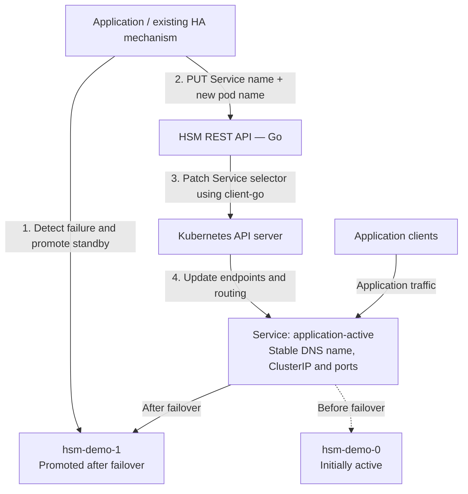

<<<<<<< HEAD
# HSM — Service Target Manager

A lightweight Go REST service that updates Kubernetes Service routing when an
application fails over from one pod to another.

HSM is intended for applications and HA components that do not have a Kubernetes
client integration. They send ordinary HTTP requests to create a Service, switch
its target pod, or delete it. HSM handles the Kubernetes API calls using the
official Go client, `client-go`.

## Use case: keep a stable endpoint during failover

Suppose an application runs as an active/standby pair:

- `hsm-demo-0` is initially active.
- `hsm-demo-1` is the standby that the application's HA mechanism can promote.
- Other components connect through a Service named `application-active`.

When the active pod fails, the existing HA mechanism detects the failure and
promotes the standby. It sends HSM a PUT request with the Service name and the new
active pod name. HSM changes the Service selector so Kubernetes routes traffic
to the new target. The Service name, ClusterIP and ports remain unchanged.

The caller only needs an HTTP client; it does not need a Kubernetes SDK or direct
Kubernetes credentials. HSM uses its own namespace-scoped ServiceAccount.

## How it works



HSM is on the management path. Application traffic flows through the Kubernetes
Service directly to the selected pod; it does not pass through HSM.

The application or HA mechanism owns failure detection, promotion and state
replication. HSM applies the target it is given. Endpoint and network updates
are asynchronous, and existing TCP connections are not migrated. Applications
still need appropriate reconnect/retry behavior.

## Features and API

| Operation | Endpoint | Result |
| --- | --- | --- |
| Create Service | `POST /api/v1/services` | Creates a ClusterIP Service targeting the requested pod; returns `201` |
| Switch target | `PUT /api/v1/services/{serviceName}/target` | Changes the selector while preserving ClusterIP and ports; returns `204` |
| Delete Service | `DELETE /api/v1/services/{serviceName}` | Deletes the managed Service, leaving pods untouched; returns `204` |
| Liveness | `GET /healthz` | Checks that the HTTP server responds |
| Readiness | `GET /readyz` | Checks Kubernetes Service-list access |

The implementation uses standard Go `net/http`, a single file for core Kubernetes
operations, and no application database. The container contains a static Go
binary in a scratch image and runs as non-root with a read-only filesystem.

## Quick start

The supplied environment scripts target macOS with Homebrew and Apple Command
Line Tools. They use Colima, Docker CLI, Minikube, kubectl, Go, Helm and jq.
`make tools` installs missing tools and preserves existing installations.
Run the following commands from the repository root.

### 1. Start infrastructure

```sh
make setup
```

This installs missing tools, downloads Go dependencies and starts the dedicated
`hsm` Colima/Minikube environment. It checks nodes, CoreDNS and storage readiness.
It does **not** create the HSM namespace or deploy the application.

If tools and dependencies are already set up, use:

```sh
make cluster-up
kubectl get nodes
kubectl get pods -A
```

Startup selects the `hsm` kubectl context with namespace `default`, preserving
other cluster entries. No manual kubeconfig exports are needed.

### 2. Build and deploy HSM

```sh
make test
make image
make hsm-deploy
```

`make image` builds a Linux binary for the Colima architecture, builds the image,
and loads it into Minikube. `make hsm-deploy` creates `hsm-system`, its
ServiceAccount/RBAC, the manager Deployment and its API Service. It checks
readiness and permissions, then selects namespace `hsm-system`.

`make deploy` is an alias. Application deployment lives in
[scripts/hsm-deploy.sh](scripts/hsm-deploy.sh), separately from infrastructure startup.

### 3. Start the demo and expose the API

```sh
make demo
make port-forward
```

The demo creates two HTTP-serving StatefulSet pods, one per Minikube node. Both
are Ready so requests can select either one; the demo does not implement a real
election or standby-promotion protocol.

Keep the port-forward terminal running. The HSM API is available at
`http://localhost:8080`. Use a second terminal for the requests below.

## Worked example: observed project output

The following excerpts are from a manual create → switch target → delete run on
20 November 2026. IP addresses and resource ages vary between environments.
Incidental HTTP headers and unrelated terminal commands are omitted.

### Create a Service targeting pod 0

```sh
curl -i -X POST http://localhost:8080/api/v1/services \
  -H 'Content-Type: application/json' \
  -d '{"serviceName":"application-active","podName":"hsm-demo-0","ports":[{"name":"http","port":8080,"targetPort":8080}]}'
```

Observed response:

```http
HTTP/1.1 201 Created
Content-Type: application/json

{"clusterIP":"10.111.231.26","namespace":"hsm-system","podName":"hsm-demo-0","ports":[{"name":"http","port":8080,"targetPort":8080}],"serviceName":"application-active"}
```

Inspect the Kubernetes Service:

```sh
kubectl -n hsm-system get svc
kubectl -n hsm-system describe svc application-active
```

Relevant output:

```text
NAME                     TYPE        CLUSTER-IP      EXTERNAL-IP   PORT(S)
application-active       ClusterIP   10.111.231.26   <none>        8080/TCP
hsm-demo                 ClusterIP   None            <none>        8080/TCP
service-target-manager   ClusterIP   10.98.31.87     <none>        8080/TCP

Name:         application-active
Namespace:    hsm-system
Labels:       app.kubernetes.io/managed-by=service-target-manager
Selector:     statefulset.kubernetes.io/pod-name=hsm-demo-0
Type:         ClusterIP
IP:           10.111.231.26
Port:         http  8080/TCP
TargetPort:   8080/TCP
Endpoints:    10.244.1.4:8080
```

The new Service selects `hsm-demo-0` and exposes a stable address for callers.

### Switch to pod 1 after failover

Once the external HA mechanism has promoted the standby, it sends the equivalent
of this request:

```sh
curl -i -X PUT http://localhost:8080/api/v1/services/application-active/target \
  -H 'Content-Type: application/json' \
  -d '{"podName":"hsm-demo-1"}'
```

Observed response:

```http
HTTP/1.1 204 No Content
```

Inspect the same Service again:

```sh
kubectl -n hsm-system describe svc application-active
```

Relevant output:

```text
Name:         application-active
Namespace:    hsm-system
Labels:       app.kubernetes.io/managed-by=service-target-manager
Selector:     statefulset.kubernetes.io/pod-name=hsm-demo-1
Type:         ClusterIP
IP:           10.111.231.26
Port:         http  8080/TCP
TargetPort:   8080/TCP
Endpoints:    10.244.0.3:8080
```

The selector changed from `hsm-demo-0` to `hsm-demo-1`, and the endpoint changed
from `10.244.1.4:8080` to `10.244.0.3:8080`. The Service ClusterIP stayed
**`10.111.231.26`** and its port stayed **`8080`**. Clients keep using the same
Service address.

To additionally check real traffic through the Service, run this after each
target change (retry briefly while routing converges):

```sh
kubectl -n hsm-system exec hsm-demo-0 -- wget -qO- http://application-active:8080
```

The expected response is the selected pod's name: initially `hsm-demo-0`, then
`hsm-demo-1`. This is a traffic check in addition to the supplied Service output.

### Delete the Service

```sh
curl -i -X DELETE http://localhost:8080/api/v1/services/application-active
```

Observed response:

```http
HTTP/1.1 204 No Content
```

```sh
kubectl -n hsm-system get svc
```

Relevant output:

```text
NAME                     TYPE        CLUSTER-IP    EXTERNAL-IP   PORT(S)
hsm-demo                 ClusterIP   None          <none>        8080/TCP
service-target-manager   ClusterIP   10.98.31.87   <none>        8080/TCP
```

`application-active` is gone. The demo's headless Service and HSM's API Service
remain. Deleting a managed Service does not delete its target pods.

## Make command reference

| Command | Purpose / when to use it |
| --- | --- |
| `make help` | Show available commands |
| `make tools` | Install missing macOS CLI tools; does not start a cluster |
| `make doctor` | Inspect tool versions and host capacity |
| `make deps` | Download pinned Go dependencies |
| `make setup` | Run tools → dependencies → infrastructure startup; no application deployment |
| `make cluster-up` | Start/resume Colima and Minikube, verify infrastructure and configure kubectl |
| `make cluster-verify` | Check nodes, CoreDNS and storage independently of HSM |
| `make cluster-down` | Stop the project cluster and VM, preserving data and deployed resources |
| `make test` | Run shell syntax checks, Go unit/HTTP tests and `go vet` |
| `make shell-check` | Check shell script syntax only |
| `make build` | Build the native debug binary at `bin/manager`; does not build an image |
| `make image` | Build the Linux binary/image and load it into the running Minikube cluster |
| `make hsm-deploy` / `make deploy` | Create namespace/RBAC and deploy/restart HSM using the loaded image |
| `make hsm-verify` | Check HSM rollout, API Service and namespace permissions |
| `make demo` | Deploy two demo pods and their headless Service; requires the HSM namespace |
| `make smoke` | Test curl create/update/delete, endpoints, traffic and stable ClusterIP; requires HSM and demo pods |
| `make port-forward` | Expose HSM on localhost:8080; leave the terminal running |

After changing Go code, use `make test image hsm-deploy`. Building an image alone
does not restart the application. The local deployment uses `imagePullPolicy:
Never` and a reused `service-target-manager:local` tag, so the deploy script
restarts the manager to pick up the newly loaded image.

## Testing

Unit tests use the Kubernetes fake client and Go HTTP test utilities. They cover
creation, duplicate requests, target validation, selector updates that preserve
other fields, deletion, ownership checks and error responses.

The live smoke test uses curl from the host through a temporary loopback
port-forward. It checks EndpointSlice convergence and actual HTTP traffic through
the Service, verifies an unchanged ClusterIP, tests repeated deletion, and confirms
that the manager's own API Service cannot be deleted through this API.

```sh
make test
make smoke
```

Smoke evidence is saved under `work/smoke/`. On success, the temporary Service is
deleted; HSM and demo pods remain available for manual testing. On failure, the
test Service is retained for inspection and the temporary port-forward is closed.
See [the test plan and recorded results](docs/TESTPLAN.md).

## Service contract and operational scope

- Targets must be Ready, non-terminating pods in the configured namespace, with
  `statefulset.kubernetes.io/pod-name` matching the requested pod name. StatefulSet
  pods carry this label; pod metadata names alone are not Service selectors.
- Created Services are marked
  `app.kubernetes.io/managed-by=service-target-manager`. Updates/deletes require
  that label. An existing non-headless ClusterIP Service can be explicitly
  enrolled by applying that label after reviewing it.
- Updates replace the entire selector, preserving other Service settings.
  POST on an existing name returns `409`; PUT on an absent Service returns `404`;
  DELETE of an absent Service returns `204`.
- Requests use numeric TCP ports. Invalid JSON, unknown fields and oversized
  bodies are rejected. See [the detailed API contract](docs/API.md).
- Resource-version preconditions reject concurrent changes. Callers must
  serialize activation decisions; HSM does not fence delayed or stale decisions.
- This implementation assumes trusted internal callers and has no REST caller
  authentication. Kubernetes RBAC scopes the manager to `hsm-system`; supplied
  local access uses loopback port-forwarding.

## Stop or undeploy

To stop working and release the VM's running CPU/RAM usage:

```sh
make cluster-down
```

This preserves the cluster. `make cluster-up` resumes it, and Kubernetes resumes
previously deployed workloads. Infrastructure startup does not apply application
manifests, but it also does not uninstall existing workloads.

To remove the application and demo while leaving infrastructure running:

```sh
kubectl --context=hsm -n hsm-system delete deployment service-target-manager --ignore-not-found
kubectl --context=hsm -n hsm-system delete statefulset hsm-demo --ignore-not-found
kubectl --context=hsm -n hsm-system delete service service-target-manager hsm-demo --ignore-not-found
```

These commands preserve namespace/RBAC and separate Services created through the
API. Delete those managed Services through HSM before undeploying it if they are
no longer needed. Redeploy with `make hsm-deploy demo` using the loaded image,
or run `make image` first if rebuilding.

## Configuration and local environment

| Setting | Default |
| --- | --- |
| `HSM_NAMESPACE` | `hsm-system`; deployment reads its own namespace |
| `HSM_LISTEN_ADDR` | `:8080` |
| Colima / Minikube profile | `hsm` |
| Docker context | `colima-hsm` |
| Colima VM | 4 CPUs, 6 GiB RAM, 30 GiB runtime disk |
| Minikube | 2 nodes, 2 CPUs / 2048 MiB each, Docker driver with containerd |
| Kubernetes / client-go | `v1.37.0` / `v0.37.0` |

For local debugging, `make build && ./bin/manager` uses the active kubeconfig.
Inside Kubernetes, HSM uses its ServiceAccount credentials.

Scripts keep an internal kubeconfig and ownership record under `work/setup/`.
Keep `work/setup/managed-environment` for safe profile reuse. Credentials and
generated evidence are ignored by Git. Infrastructure startup also refreshes the
normal kubectl context, so manual exports are unnecessary.

The node budgets sit inside the Colima VM budget. Both nodes share one host VM;
this setup demonstrates pod routing changes, not resilience to host failure.

## Project structure

```text
cmd/manager/           HTTP server entrypoint and graceful shutdown
internal/api/          REST handlers and HTTP tests
internal/config/       Environment configuration
internal/kubernetes/   services.go: core Service operations and unit tests
deploy/local/          Namespace/RBAC, HSM and demo manifests
scripts/               Infrastructure, build, deployment and smoke-test scripts
docs/                  API contract and test plan
Dockerfile             Minimal runtime image
Makefile               Development and lifecycle commands
go.mod / go.sum        Pinned Go dependencies
work/                  Ignored local configuration and test evidence
```

Start with [internal/kubernetes/services.go](internal/kubernetes/services.go) for
the core logic and [internal/api/handlers.go](internal/api/handlers.go) for request
handling. The module path `github.com/Dhiraj1729/TargetServiceUpdate` is a placeholder
until a repository remote is chosen. Deployment currently uses plain Kubernetes
manifests; the reserved Helm directory does not contain a usable chart yet.
=======
# TargetServiceUpdate
Updates the Workload in Kubernetes services when there is a failover.
>>>>>>> origin/main
